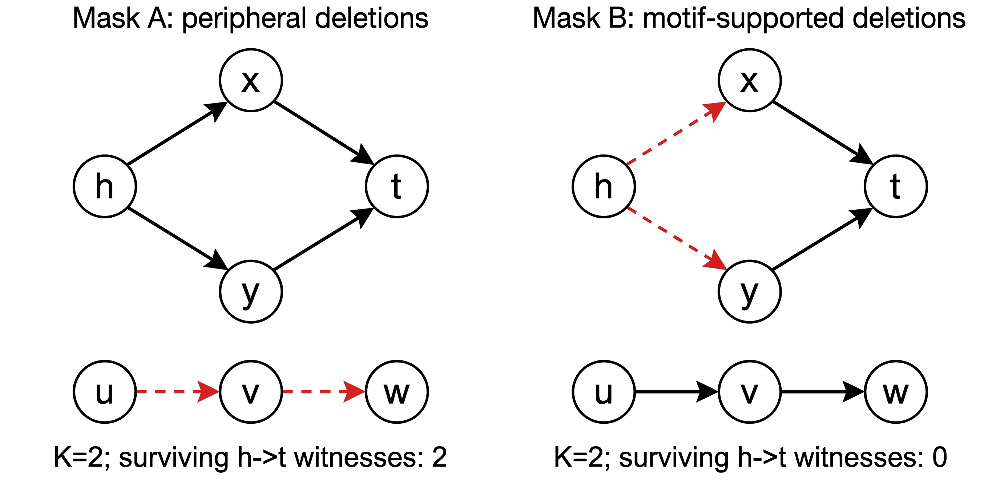

# RIMES-KG: Relational Evidence Survival for Robust Knowledge Graph Completion

Official repository for the paper:
**"Beyond Random Edge Removal: Evidence Survival under Relational Missingness Shifts in Knowledge Graph Completion"** (*Under Review at DASFAA 2027*).

[](https://www.python.org/downloads/)
[](https://pytorch.org/)
[](https://opensource.org/licenses/MIT)

---

## 📌 Overview

Standard evaluations of Knowledge Graph Completion (KGC) predominantly operate under the **uniform edge-dropping fallacy**, presuming that missing facts are Missing Completely at Random (MCAR) and that equal deletion budgets inflict equivalent topological damage. 

In real-world knowledge graphs, link missingness is structurally clustered due to predicate sparsity, entity degree skew, and localized multi-hop extraction blindspots.

<p align="center">
  
  <br>
  <em>Figure 1: Conceptual comparison between uniform edge deletion and motif-clustered missingness under an identical edge-removal budget.</em>
</p>

### Key Insights & Findings
1. **The Fallacy of Uniform Edge Deletion**: Under matched removal budgets ($K$), motif-clustered missingness (M4) inflicts up to **$12.14\times$ higher destruction** on two-hop relational witness paths than uniform deletion (M1).
2. **Decoupled Evaluation Protocols (P1 & P2)**: We disentangle training observation missingness (**Protocol P1**: independent retraining) from fixed-supervision inference contextual shift (**Protocol P2**).
3. **Exact Marginal-Controlled Null Model (Null-M4)**: Null-M4 matches relation frequency and endpoint degree marginals of M4 via stratified permutation, proving that motif clustering exerts an independent synergistic degradation penalty beyond first-order marginals ($-0.0156$ on CoDEx-M).
4. **Law of Concentrated Vulnerability**: Inferential ranking collapse is heavily concentrated on the **14.7% of queries supported by explicit topological witness paths** ($12.3\times$ to $65.0\times$ steeper reciprocal rank drops), whereas the 85.3% unsupported queries rely on static embeddings and remain virtually immune.
5. **RIMES-KG Defense**: A dual-view framework coupling query-level witness damage estimation $d(q,m)$ with teacher margin gating $g(q)$ under intra-batch weight mass normalization ($\sum \tilde{w}_i = 1$). RIMES-KG reduces worst-case inference degradation by **36.8% on CoDEx-M** and **22.2% on CoDEx-S**, requiring $<0.09$ GPU-hours and achieving sub-millisecond inference latency ($0.095\text{ms}$).

---

## 📂 Repository Structure

```text
RIMES-KG/
├── configs/                  # Protocol & experiment configurations
│   ├── full_s.yaml           # Full CoDEx-S benchmark configuration (5 seeds)
│   ├── full_m.yaml           # Full CoDEx-M benchmark configuration (5 seeds)
│   └── pilot_s.yaml          # Fast excerpt pilot configuration
├── data/                     # Verified benchmark datasets
│   ├── codex-s/              # CoDEx-S (2,034 entities, 42 relations, 32,888 train)
│   └── codex-m/              # CoDEx-M (17,050 entities, 51 relations, 185,584 train)
├── results/                  # Complete empirical outputs & audit tables
│   ├── official_combined/    # Aggregated results across CoDEx-S & CoDEx-M
│   │   ├── figures/          # High-resolution publication figures (Fig1–Fig8)
│   │   └── tables/           # Benchmark tables in CSV & LaTeX (Table1–Table6)
│   ├── official_s/           # CoDEx-S raw logs and metrics
│   └── official_m/           # CoDEx-M raw logs and metrics
├── scripts/                  # Execution & utility scripts
│   ├── run_experiments.py    # Main training and evaluation entrypoint
│   └── profile_test.py       # Performance & memory profiler
├── src/rimeskg/              # Core RIMES-KG library
│   ├── data.py               # Data loaders, transductive splits & checksum verification
│   ├── masks.py              # Missingness families (M1, M2, M3, M4, Null-M4)
│   ├── witnesses.py          # 2-hop relational witness template mining & damage calculation
│   ├── models.py             # R-GCN encoder, ComplEx decoder, static baselines
│   ├── training.py           # Dual-view teacher-student consistency & baseline learners
│   ├── evaluation.py         # Full-entity filtered ranking evaluator (MRR, Hits@K)
│   └── runner.py             # End-to-end experiment orchestrator
├── tests/                    # Comprehensive unit tests
├── requirements.txt          # Python dependencies
├── pyproject.toml            # Project packaging specification
└── LICENSE                   # MIT License
```

---

## ⚡ Quick Start

### 1. Installation

```bash
# Clone the repository
git clone https://github.com/zhongguodeshizhe007/RIMES-KG.git
cd RIMES-KG

# Create virtual environment
python -m venv .venv
source .venv/bin/activate  # On Windows: .venv\Scripts\activate

# Install dependencies
pip install -r requirements.txt
pip install -e .
```

### 2. Verify Datasets

Both CoDEx-S and CoDEx-M are pre-packaged under `data/` with SHA-256 integrity manifests:

```bash
rimes verify --root data --dataset s
rimes verify --root data --dataset m
```

Expected benchmark statistics:
| Dataset | Entities $|\mathcal{E}|$ | Relations $|\mathcal{R}|$ | Train $|\mathcal{T}_{\text{tr}}|$ | Valid $|\mathcal{T}_{\text{val}}|$ | Test $|\mathcal{T}_{\text{test}}|$ | Context $|\mathcal{C}|$ | Positives $|\mathcal{L}|$ |
| :--- | :---: | :---: | :---: | :---: | :---: | :---: | :---: |
| **CoDEx-S** | 2,034 | 42 | 32,888 | 1,827 | 1,828 | 24,666 | 8,222 |
| **CoDEx-M** | 17,050 | 51 | 185,584 | 10,310 | 10,311 | 139,187 | 46,397 |

### 3. Run Experiments

#### Fast Verification Pilot (Excerpt Mode)
```bash
rimes run --config configs/pilot_s.yaml --data-root data --output results/pilot_run --max-queries 100
```

#### Full Official Reproductions
```bash
# Run CoDEx-S protocol (P1 paired retraining + P2 fixed-supervision shift)
rimes run --config configs/full_s.yaml --data-root data --output results/official_s --mode all

# Run CoDEx-M protocol
rimes run --config configs/full_m.yaml --data-root data --output results/official_m --mode all

# Generate publication tables and figures
rimes render --input results/official_combined
```

---

## 📊 Summary of Main Results

### Protocol P1: Retraining Vulnerability
Under identical edge removal budget ($\rho=0.2, 0.4$), motif-clustered missingness (M4) inflicts severe ranking drops compared to uniform removal (M1), and exceeds the exact marginal-controlled Null-M4 by statistically significant margins:
- CoDEx-M ($\rho=0.2$): Net synergistic penalty $\Delta_{\text{M4-Null}} = -0.0156$
- CoDEx-S ($\rho=0.4$): Net synergistic penalty $\Delta_{\text{M4-Null}} = -0.0076$ (ComplEx) and $-0.0142$ (DistMult)

### Protocol P2: Inference Contextual Shift Resilience
| Dataset | Method | Clean MRR | M3 (Degree) | M4 (Motif) | Worst MRR | Worst-Clean Drop [95% CI] | Training Time | Latency |
| :--- | :--- | :---: | :---: | :---: | :---: | :---: | :---: | :---: |
| **CoDEx-M** | ERM | 0.1272 | 0.1262 | 0.1255 | 0.1253 | $-0.0019$ [$-0.0043, +0.0006$] | 145.5s | 0.196ms |
| **CoDEx-M** | **RIMES-KG** | 0.1158 | 0.1157 | 0.1146 | 0.1146 | **$-0.0012$** [$-0.0030, +0.0007$] | 313.6s | 0.193ms |
| **CoDEx-S** | ERM | 0.1869 | 0.1872 | 0.1839 | 0.1832 | $-0.0036$ [$-0.0147, +0.0075$] | 72.1s | 0.095ms |
| **CoDEx-S** | DropEdge | 0.1860 | 0.1867 | 0.1829 | 0.1829 | $-0.0031$ [$-0.0072, +0.0010$] | 64.3s | 0.095ms |
| **CoDEx-S** | Group-DRO | 0.1923 | 0.1915 | 0.1894 | 0.1893 | $-0.0031$ [$-0.0101, +0.0040$] | 72.4s | 0.097ms |
| **CoDEx-S** | **RIMES-KG** | 0.1721 | 0.1722 | 0.1698 | 0.1693 | **$-0.0028$** [$-0.0108, +0.0053$] | 109.1s | 0.101ms |

---

## 📝 Citation

If you find this work useful in your research, please cite our paper:

```bibtex
@inproceedings{rimeskg2027dasfaa,
  title     = {Beyond Random Edge Removal: Evidence Survival under Relational Missingness Shifts in Knowledge Graph Completion},
  author    = {Anonymous},
  booktitle = {Proceedings of the 32nd International Conference on Database Systems for Advanced Applications (DASFAA)},
  year      = {2027}
}
```

---

## 📜 License

This project is licensed under the MIT License - see the [LICENSE](LICENSE) file for details.
